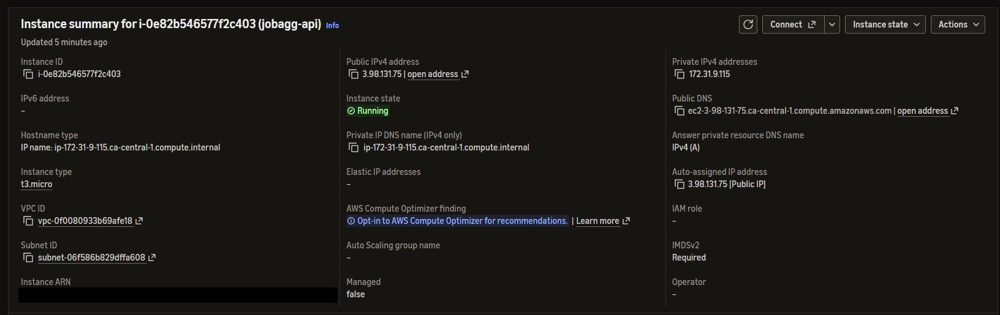
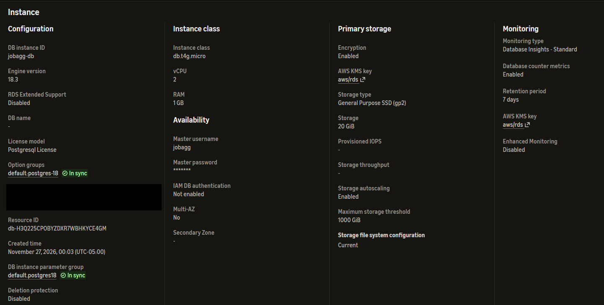
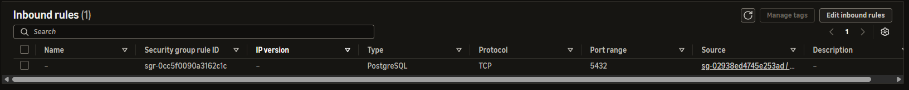
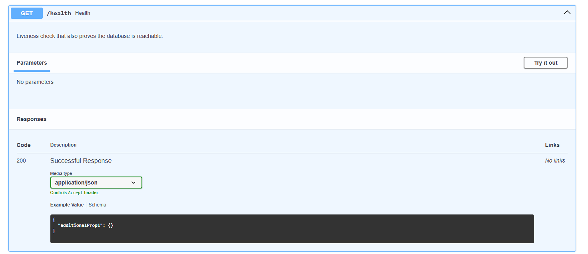

# Internship Posting Aggregator

[](https://github.com/Ruweener/Job_Posting_Aggregator/actions/workflows/ci.yml)

A Python service that pulls internship postings from public job-board APIs
(Greenhouse, Lever, Ashby), stores them in PostgreSQL, and (in later stages)
scores them against my skills and serves them through a FastAPI REST API.

**Status:** Stages 1–4 complete (ingest, REST API, fit scoring, 103 tests, CI + scheduled ingest). Stage 5 complete: deployed on AWS (EC2 + RDS) with a daily ingest. Next: Stage 6 (React front end).

## Stack
Python 3.12 · FastAPI · PostgreSQL 16 · SQLAlchemy 2 · Alembic · httpx · pytest · respx · Docker · GitHub Actions · AWS (EC2, RDS)

## How it works

```
companies.yaml ──> fetch() ──> parse() ──> NormalizedPosting ──> is_internship? ──> upsert into Postgres
  (which boards)   (HTTP only)  (pure, per board)  (one shape)        (filters.py)       (ON CONFLICT)
                                                                                     └─> close postings no longer listed
```

- **One fetcher per board** (`app/fetchers/greenhouse.py`, `lever.py`, `ashby.py`). Each has a
  `fetch()` that only does HTTP and a pure `parse()` that turns that board's JSON into the common
  `NormalizedPosting` shape. Adding a board means one new module and one line in `FETCHERS`.
- **Only internships are stored**: the title (or the board's own job-type label) must say
  intern, internship, co-op or student.
- **Idempotent upserts:** `INSERT ... ON CONFLICT (source, source_job_id) DO UPDATE`, so running
  ingest again refreshes rows instead of duplicating them. `first_seen_at` is kept; `last_seen_at` moves.
- **Closing postings:** after a company's board is fetched successfully, its postings that are no
  longer listed get `is_open = false`. A failed fetch skips the company, so an outage never closes
  everything.
- **Term detection:** `Winter 2027` / `Summer 2027` / etc. from the title, falling back to the
  description, skipping graduation dates ("graduating in spring 2028").
- **Fit scoring (0–10):** each skill in `skills.yaml` has a weight and regex patterns;
  `fit_score = min(10, round(10 × matched weight ÷ full_match_weight))`. Each skill counts once,
  so long descriptions don't win by repetition. Edit `skills.yaml` and re-run ingest to re-score.
- **Flags:** `in_target_area` (Ontario or remote in Canada) and `coop_required` (the posting says
  you must be in a co-op program; some also offer a regular internship track, so read before skipping).
- **Polite to APIs:** sequential requests, 1 s between companies, 20 s timeout, no scraping or logins.

## Setup (Windows, PowerShell)

Requires Python 3.12 and Docker Desktop.

```powershell
# 1. Python environment
py -3.12 -m venv .venv
.venv\Scripts\Activate.ps1
pip install -r requirements.txt

# 2. Settings: copy the template, then change the password in BOTH lines
copy .env.example .env

# 3. Start Postgres (host port 5433) and create the tables
docker compose up -d --wait db
alembic upgrade head
python -m app.check_db
```

## Run

```powershell
python -m app.ingest      # fetch all boards in companies.yaml and upsert internships
pytest                    # run the test suite
```

**Tests** (`pytest`, 103 tests):
- Parsers, filters and scoring run offline against trimmed real API responses in `tests/fixtures/`;
  HTTP is mocked with `respx`.
- Database and API tests use a separate `jobagg_test` database (created and migrated with
  Alembic automatically). Each test runs in a transaction that is rolled back, so tests are
  isolated and the dev database is never touched. Set `TEST_DATABASE_URL` to use another server.
- If Postgres isn't running, the database tests are skipped and the rest still run.

Run the API:

```powershell
uvicorn app.main:app --reload    # then open http://127.0.0.1:8000/docs
```

| Endpoint | What it returns |
|---|---|
| `GET /postings` | Open internships, newest first. Filters: `term`, `location` (substring), `remote`, `company`, `q` (keyword in title/description), `min_score`, `in_target_area`, `hide_coop_required`, `include_closed`. Sort: `sort=newest` (default) or `sort=score`. Paging: `limit` (1–100), `offset`. |
| `GET /postings/{id}` | One posting including its full description; 404 if missing |
| `GET /stats` | Totals plus counts by company, by week posted (`weeks`, default 12) and by term, as raw SQL `GROUP BY` |
| `GET /health` | `{"status": "ok"}` if the API can reach the database |

Example: `GET /postings?in_target_area=true&sort=score&term=Winter%202027`

Look at the data directly:

```powershell
docker exec -it jobagg-db psql -U jobagg -d jobagg
```
```sql
SELECT company, title, location, term FROM postings WHERE is_open ORDER BY first_seen_at DESC;
```

## Run in Docker

The `Dockerfile` packages the API. `docker compose up` starts Postgres and the API together:

```powershell
docker compose up -d --build --wait      # build the image, start db + api
docker compose run --rm api alembic upgrade head   # migrations, with the image's code
docker compose run --rm api python -m app.ingest   # ingest from inside a container
docker compose logs -f api               # follow the API's logs
docker compose down                      # stop both (data is kept in the pgdata volume)
```

The API is then at http://localhost:8000/docs. Inside Docker's network the API reaches
Postgres at `db:5432`, so `docker-compose.yml` builds that `DATABASE_URL` from the `.env` values.
`.dockerignore` keeps `.env` out of the image: the database URL is always passed in at run time.

## CI and the daily ingest

Two GitHub Actions workflows live in `.github/workflows/`:

| Workflow | When | What |
|---|---|---|
| `ci.yml` | Every push and pull request | Starts a throwaway Postgres 16 service container, runs `alembic upgrade head`, `alembic check` (models and migrations match), then the full test suite |
| `ingest.yml` | Daily at 11:00 UTC, or manually from the Actions tab | Runs migrations and `python -m app.ingest` against the hosted database in the `DATABASE_URL` secret. Fails (and GitHub emails you) if no company could be ingested |

One-time setup for the daily ingest (free Neon Postgres):
1. Create a project at [neon.tech](https://neon.tech) (Postgres 16) and copy its connection string
   (`postgresql://...neon.tech/neondb?sslmode=require`). It can be pasted as is: the app converts
   `postgresql://` to the psycopg 3 driver automatically.
2. In the GitHub repo: **Settings → Secrets and variables → Actions → New repository secret**,
   name `DATABASE_URL`, value the connection string.
3. **Actions → Daily ingest → Run workflow** to run it once now.

Note: GitHub turns off scheduled workflows in public repos after 60 days without commits.

## Deployment (AWS)

The API runs on AWS in the `ca-central-1` (Canada Central) region:

```
Internet ──:8000──> EC2 t3.micro (Amazon Linux 2023)
                      Docker container: FastAPI + uvicorn
                      systemd timer: daily ingest container
                         │
                         │ port 5432, private network only
                         ▼
                    RDS PostgreSQL 18 (db.t4g.micro, no public address)
```

**Network security** uses two security groups (AWS's per-resource firewalls):

| Security group | Inbound rules |
|---|---|
| `jobagg-api-sg` (EC2) | SSH (22) from my IP only; API (8000) from anywhere |
| `jobagg-db-sg` (RDS) | PostgreSQL (5432) only from `jobagg-api-sg` |

The database has no public IP. The only thing that can connect to it is a server in the API's
security group. The rule names a group rather than an IP, so it still works if the server is replaced.

**Secrets:** the RDS connection string is only in `~/jobagg.env` on the server (readable only by
its owner) and is passed to containers with `docker run --env-file`. It's never in the repo or the image
(`.dockerignore` excludes `.env`). The connection uses TLS (`sslmode=require`).

**Running the API:**

```bash
docker build -t jobagg-api .
docker run -d --name jobagg-api --restart unless-stopped   --env-file ~/jobagg.env -p 8000:8000 jobagg-api
```

`--restart unless-stopped` brings the API back after a crash or a reboot.

**Daily ingest:** `deploy/jobagg-ingest.timer` starts `deploy/jobagg-ingest.service` at 11:30 UTC.
The service runs `alembic upgrade head` and then `python -m app.ingest`, each in a short-lived
container from the same image. `Persistent=true` catches up on a missed run if the server was off.
Logs are in `journalctl -u jobagg-ingest`.

```bash
sudo cp deploy/jobagg-ingest.* /etc/systemd/system/
sudo systemctl daemon-reload
sudo systemctl enable --now jobagg-ingest.timer
```

**Deploying a change:**

```bash
cd ~/Job_Posting_Aggregator && git pull
docker build -t jobagg-api .
docker run --rm --env-file ~/jobagg.env jobagg-api alembic upgrade head
docker rm -f jobagg-api
docker run -d --name jobagg-api --restart unless-stopped --env-file ~/jobagg.env -p 8000:8000 jobagg-api
```

**Account setup:** the root user has MFA and is not used day to day. Work is done as an IAM user
in an `Admins` group (also with MFA). An AWS Budgets alert emails me when monthly cost passes $5.

There are two hosted databases: the GitHub Actions ingest fills a free Neon Postgres, and the EC2
timer fills RDS. Both run the same code, configured only by `DATABASE_URL`. (RDS runs Postgres 18;
CI and local dev use 16. The app uses nothing version-specific.)

**Screenshots** (account ID redacted):

| | |
|---|---|
| EC2 instance running |  |
| RDS instance (Postgres 18, db.t4g.micro, encrypted storage) |  |
| `jobagg-db-sg`: port 5432 open only to the API's security group |  |
| The live API's interactive docs |  |

## Adding a company

Find the board token in the company's careers URL (`boards.greenhouse.io/<token>`,
`jobs.lever.co/<token>`, `jobs.ashbyhq.com/<token>`), then add a line to `companies.yaml`:

```yaml
- { name: Example Co, source: greenhouse, token: exampleco }
```

## Project layout

```
app/
  config.py         settings from environment / .env
  db.py             SQLAlchemy engine and session
  models.py         Posting table
  schemas.py        NormalizedPosting (common shape for all boards)
  filters.py        is_internship, detect_term, is_remote
  scoring.py        fit score from skills.yaml, co-op and target-area flags
  fetchers/         greenhouse.py, lever.py, ashby.py, html_text.py
  ingest.py         python -m app.ingest
  main.py           FastAPI app (uvicorn app.main:app)
  api/              postings.py, stats.py, models.py (response shapes), deps.py
alembic/            database migrations
deploy/             systemd service + timer for the daily ingest on EC2
Dockerfile          API image (also used for migrations and ingest)
tests/              pytest suite + fixtures/ (trimmed real API responses)
companies.yaml      which boards to ingest
skills.yaml         my skills and weights for fit scoring
```

## Roadmap

1. ~~Ingest from Greenhouse, Lever, Ashby into Postgres~~
2. ~~FastAPI: `GET /postings` (filters + pagination), `GET /postings/{id}`, `GET /stats`; indexes~~
3. ~~Fit scoring + API and database tests~~
4. ~~GitHub Actions: tests on every push, scheduled daily ingest~~
5. ~~Deploy to AWS: Docker on EC2, Postgres on RDS, daily ingest with a systemd timer~~
6. Optional React front end

## Data sources

Only public, documented job-board APIs:
[Greenhouse Job Board API](https://developers.greenhouse.io/job-board.html),
[Lever Postings API](https://github.com/lever/postings-api),
[Ashby Job Posting API](https://developers.ashbyhq.com/docs/public-job-posting-api).
